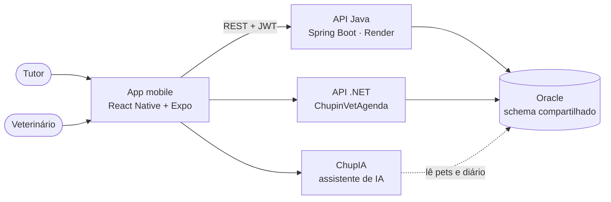

# ChupinVet API

API REST do **ChupinVet**, a solução do grupo para o **Challenge CLYVO VET 2026 (FIAP)**. Ela guarda o histórico contínuo de saúde do pet e conecta o **responsável** (tutor) ao **veterinário**, com autenticação JWT e regras de acesso por papel e por posse.

| | |
|---|---|
| **Aplicação online** | https://javachallenge.onrender.com |
| **Swagger** | https://javachallenge.onrender.com/swagger-ui/index.html |
| **Vídeo de apresentação** | Placeholder |
| **Disciplina** | Java Advanced (FIAP, 2TDS) |

> O Render (plano gratuito) desliga a aplicação depois de 15 minutos sem uso. A primeira requisição depois disso pode levar alguns segundos enquanto ela volta.

---

## Sumário
1. [O desafio e a nossa proposta](#1-o-desafio-e-a-nossa-proposta)
2. [Integrantes e divisão do trabalho](#2-integrantes-e-divisão-do-trabalho)
3. [Arquitetura da solução](#3-arquitetura-da-solução)
4. [Decisões técnicas](#4-decisões-técnicas)
5. [Segurança: papéis e posse](#5-segurança-papéis-e-posse)
6. [Fluxos funcionais completos](#6-fluxos-funcionais-completos)
7. [Testes automatizados](#7-testes-automatizados)
8. [Integração com as demais disciplinas](#8-integração-com-as-demais-disciplinas)
9. [Como executar](#9-como-executar)
10. [Endpoints](#10-endpoints)
11. [Estrutura do projeto](#11-estrutura-do-projeto)

---

## 1. O desafio e a nossa proposta

### O problema (briefing CLYVO VET)
O mercado pet tem alto potencial de recorrência, mas o responsável só procura a clínica em urgências ou em gatilhos óbvios, como a vacinação. O resultado é **baixa recorrência** (consultas e exames preventivos esquecidos), **menor LTV** (acompanhamentos e retornos perdidos) e **vínculo fraco**, porque **não existe um histórico longitudinal estruturado entre clínica e tutor**.

A CLYVO VET pede uma solução digital que acompanhe a **jornada contínua de saúde do pet**, com quatro objetivos: **organizar** eventos clínicos, **lembrar** cuidados, **personalizar** a comunicação e **gerar dados** estruturados para as clínicas parceiras.

### A proposta do ChupinVet
O ChupinVet coloca o **dia a dia do pet** no centro do cuidado. O responsável registra num **diário** como o pet está (humor, alimentação, água, comportamento, sintomas e peso), e o veterinário passa a enxergar esse histórico entre uma consulta e outra. O cuidado deixa de existir só na emergência e vira um acompanhamento contínuo.

### Como esta API atende ao briefing
| Pilar do briefing | Onde é atendido |
|---|---|
| Gerar dados (histórico longitudinal) | **API Java:** diário do pet em ordem cronológica |
| Bem-estar (nutrição, comportamento) | **API Java:** campos do diário |
| Vínculo clínica ↔ tutor | **API Java:** o veterinário consulta pets e diários de qualquer tutor; o tutor só vê os seus |
| Organizar eventos clínicos | **API .NET (ChupinVetAgenda):** horários dos veterinários e agendamento de consultas |
| Personalização com IA | **ChupIA:** resume e compara os registros do diário e aponta mudanças no histórico |

---

## 2. Integrantes e divisão do trabalho

| Nome | RM | Turma | Responsabilidade no projeto |
|---|---|---|---|
| Agatha Yie Won Yun | RM561507 | 2TDSA | App mobile (Mobile Application Development) |
| Ana Claudia Fernandes Martins | RM561190 | 2TDSR | Banco de dados (Mastering Relational and Non-Relational Database) e qualidade (Compliance, Quality Assurance & Tests) |
| Samantha Faruolo Galdi | RM554794 | 2TDSA | API .NET (Advanced Business Development with .NET) e IA (Disruptive Architectures: IoT, IoB & Generative AI) |
| Vitor Fria Dalmagro | RM566052 | 2TDSA | API Java (Java Advanced) e nuvem/CI-CD (DevOps Tools & Cloud Computing) |

---

## 3. Arquitetura da solução



- **App mobile:** a interface usada pelo responsável e pelo veterinário. Consome esta API via REST, usando o mesmo fluxo de autenticação JWT descrito na seção 5.
- **API Java (este repositório):** identidade, papéis, pets e diário. Concentra as regras de negócio e de acesso.
- **API .NET (ChupinVetAgenda):** horários dos veterinários e agendamento de consultas, no mesmo banco.
- **ChupIA:** assistente de IA que responde, em linguagem natural, perguntas sobre os dados do pet e do diário.
- **Banco Oracle:** um único schema compartilhado entre as duas APIs.

### Camadas da API Java
| Camada | Responsabilidade |
|---|---|
| `controller` | Endpoints REST e restrição por papel (`@PreAuthorize`) |
| `service` | Regras de negócio e checagem de posse |
| `repository` | Acesso ao banco via Spring Data JPA |
| `dto` | O que entra (`*RequestDTO`) e o que sai (`*ResponseDTO`) da API |
| `model` | Entidades JPA mapeadas para o schema Oracle |
| `security` | JWT, filtro de autenticação, regras de rota e utilitários de posse |
| `exception` | Tradução centralizada de erros para respostas HTTP |
| `config` | Swagger com autenticação Bearer |

---

## 4. Decisões técnicas

- **Papel derivado no login:** não existe uma coluna "tipo". O papel vem da tabela onde o usuário existe (responsável ou veterinário), e `Responsavel`/`Veterinario` se ligam ao `Usuario` por composição (`@OneToOne`), como no modelo físico do banco.
- **Dono vem do token:** o dono de um pet ou diário nunca é informado pelo cliente, e sim tirado do JWT. Isso impede criar recursos em nome de outra pessoa.
- **`ddl-auto=validate`, sem Flyway:** o schema é compartilhado com a API .NET e mantido por script. A aplicação nunca altera o banco.
- **Código sem repetição:** injeção por construtor; um `UsuarioService` com as regras de identidade (e-mail e CPF únicos, senha com BCrypt) compartilhado pelos dois tipos de cadastro; e o `SecurityUtils` como ponto único das regras de posse.
- **Logs detalhados só em `dev`:** em produção, os logs de SQL exporiam dados como CPF.

### Tecnologias
- Java 25 e Spring Boot 4.0.6 (Spring Security 7)
- Spring Data JPA / Hibernate 7 e Oracle (ojdbc11)
- JWT (jjwt 0.13), BCrypt e Bean Validation
- Lombok e springdoc-openapi (Swagger)
- JUnit 5, Mockito, MockMvc e H2 (testes)
- Maven

---

## 5. Segurança: papéis e posse

A API usa **JWT (Bearer token)**. Não existe um endpoint separado de "signup": cadastrar um responsável (`POST /responsaveis`) ou um veterinário (`POST /veterinarios`) já cria a conta de login.

| Papel | Pode fazer |
|---|---|
| `ROLE_RESPONSAVEL` | CRUD dos próprios pets e diários e do próprio cadastro |
| `ROLE_VETERINARIO` | Consultar pets, diários e responsáveis de qualquer tutor; CRUD do próprio cadastro |

Além do papel, existe a checagem de **posse**: um responsável não vê, não edita e não apaga pets, diários ou o cadastro de **outro** responsável, mesmo com um token válido. Essas tentativas retornam `403`.

**Rotas públicas:** `POST /responsaveis`, `POST /veterinarios`, `POST /auth/login` e o Swagger. Todas as outras exigem token.

| Código | Quando acontece |
|---|---|
| `400` | Dados inválidos. O corpo indica o campo e o motivo |
| `401` | Sem token, token inválido ou login incorreto |
| `403` | O papel não permite, ou o recurso pertence a outro responsável |
| `404` | O recurso não existe |
| `409` | E-mail ou CPF já cadastrado |

---

## 6. Fluxos funcionais completos

### Fluxo 1: autenticação e identidade (cadastro → login → JWT → papel)
1. `POST /responsaveis` ou `POST /veterinarios` cria o `Usuario` e o registro do papel numa única transação. A senha é gravada com hash BCrypt, e e-mail e CPF duplicados retornam `409`.
2. `POST /auth/login` valida a senha e devolve o token JWT, junto com o papel e os ids do usuário.
3. A cada requisição, o filtro JWT carrega o usuário e descobre o papel pela tabela onde ele existe.
4. Esse papel libera ou bloqueia as rotas (`@PreAuthorize`).

### Fluxo 2: acompanhamento contínuo do pet, com controle de posse
1. O responsável cadastra o pet. O dono é sempre quem está logado.
2. O responsável registra o diário do pet (humor, alimentação, água, comportamento, sintomas, peso). Só o dono do pet pode registrar.
3. O histórico fica disponível em ordem cronológica (`GET /diarios/pet/{idPet}`).
4. O veterinário consulta os pets e os históricos de qualquer responsável para acompanhar o paciente entre as consultas. Um responsável que tenta ver o pet de outro recebe `403`.

---

## 7. Testes automatizados

São **26 testes**, que rodam com:
```bash
./mvnw clean test
```
Eles usam o perfil `test` (`src/test/resources/application-test.properties`), com um **banco H2 em memória** criado e apagado a cada execução. **Não precisam do Oracle nem de credenciais**, e a chave JWT dos testes é gerada aleatoriamente.

| Tipo | Classes | O que garante |
|---|---|---|
| **Unitário de service** (JUnit + Mockito) | `UsuarioServiceTest`, `PetServiceTest`, `DiarioServiceTest`, `ResponsavelServiceTest` | Duplicidade de e-mail/CPF, recurso não encontrado, posse negada, dono do pet vindo do token, veterinário lendo pets de qualquer responsável |
| **Controller** (`@WebMvcTest`) | `PetControllerTest` | Status HTTP, JSON de resposta e validação (`400`) |
| **Integração** (`@SpringBootTest` + MockMvc) | `AutenticacaoEPosseIntegrationTest` | Os dois fluxos de ponta a ponta com a segurança real: cadastro → login → pet; `401` sem token; `409` em cadastro repetido; `403` ao acessar pet de outro; veterinário lê mas não cadastra pet |
| **Contexto** | `ChupinvetApplicationTests` | A aplicação sobe com todas as configurações |

### Testes manuais
A coleção **`Documentos/Testes_insomnia.yaml`** (Insomnia) cobre cadastro, login, CRUD e os casos de erro (`400`, `401`, `403`, `404`, `409`). As pastas devem ser executadas em ordem (01 a 07), porque os tokens e ids são preenchidos automaticamente entre as requisições.

---

## 8. Integração com as demais disciplinas

| Disciplina | Responsável | Evidência |
|---|---|---|
| Java Advanced | Vitor | Este repositório e a aplicação online |
| DevOps Tools & Cloud Computing | Vitor | https://github.com/ChupinVet/DevOpsChallenge: a API containerizada, com MySQL em nuvem e CI/CD no Azure DevOps · [PLACEHOLDER do link do video] |
| Advanced Business Development with .NET | Samantha | https://github.com/ChupinVet/ChupinVetAgenda: horários e agendamento de consultas |
| Disruptive Architectures: IoT, IoB & Generative AI | Samantha | https://github.com/ChupinVet/ChupIA: assistente que responde sobre os dados do pet e do diário, sem fazer diagnósticos |
| Mastering Relational and Non-Relational Database | Ana Claudia | Modelo Oracle em 3FN (o schema usado por esta API), packages, trigger de auditoria, exportação em JSON e MongoDB · vídeo: https://youtu.be/2jp1tLnUr90 |
| Compliance, Quality Assurance & Tests | Ana Claudia | Testes via Postman: https://youtu.be/03_GnB1PsMU |
| Mobile Application Development | Agatha | App React Native + Expo, demonstrado no vídeo. O repositório é privado (acesso só do professor de Mobile e do grupo) |

---

## 9. Como executar

### Pré-requisitos
- Java 25
- Acesso ao Oracle da FIAP (usuário e senha)

### 1. Clonar
```bash
git clone https://github.com/ChupinVet/JavaChallenge.git
cd JavaChallenge
```

### 2. Variáveis de ambiente
Usuário e senha do banco **não têm valor padrão no código**, porque o repositório é público.

| Variável | Obrigatória? | Descrição |
|---|---|---|
| `DB_USER` | Sim | Usuário do Oracle |
| `DB_PASSWORD` | Sim | Senha do Oracle |
| `DB_URL` | Não | Padrão: `jdbc:oracle:thin:@oracle.fiap.com.br:1521:orcl` |
| `JWT_SECRET` | Só em produção | Chave de assinatura do JWT, com 32 caracteres ou mais. Em `dev` existe um valor padrão |
| `JWT_EXPIRATION_MS` | Não | Validade do token em ms (padrão: 3600000 = 1 h) |
| `SPRING_PROFILES_ACTIVE` | Não | `dev` (padrão) ou `prod` |

```bash
export DB_USER=seuusuario
export DB_PASSWORD=suasenha
```

### 3. Rodar
```bash
./mvnw spring-boot:run
```
A aplicação sobe em `http://localhost:8080`, com o Swagger em `http://localhost:8080/swagger-ui/index.html`.

### 4. Testar pelo Swagger
1. Cadastre um usuário (`POST /responsaveis` ou `POST /veterinarios`).
2. Faça login (`POST /auth/login`) e copie o `token`.
3. Clique em **Authorize** e cole o token **sem** o prefixo `Bearer`.

### Produção (Render)
Perfil `prod` (`SPRING_PROFILES_ACTIVE=prod`), com `DB_URL`, `DB_USER`, `DB_PASSWORD`, `JWT_SECRET` e `JWT_EXPIRATION_MS` configurados como variáveis de ambiente no Render.

---

## 10. Endpoints

### Autenticação
| Método | Endpoint | Descrição | Acesso |
|---|---|---|---|
| POST | `/auth/login` | Login (retorna o token JWT) | Público |

### Responsáveis
| Método | Endpoint | Descrição | Acesso |
|---|---|---|---|
| POST | `/responsaveis` | Cadastra um responsável (signup) | Público |
| GET | `/responsaveis` | Lista responsáveis (paginado) | Veterinário |
| GET | `/responsaveis/{id}` | Busca por ID | Veterinário, ou o próprio responsável |
| PUT | `/responsaveis/{id}` | Atualiza | O próprio responsável |
| DELETE | `/responsaveis/{id}` | Remove | O próprio responsável |

### Veterinários
| Método | Endpoint | Descrição | Acesso |
|---|---|---|---|
| POST | `/veterinarios` | Cadastra um veterinário (signup) | Público |
| GET | `/veterinarios` | Lista veterinários (paginado) | Autenticado |
| GET | `/veterinarios/{id}` | Busca por ID | Autenticado |
| GET | `/veterinarios/especialidade?especialidade=Cardiologia` | Busca por especialidade | Autenticado |
| GET | `/veterinarios/servico?tipoServico=Consulta` | Busca por tipo de serviço | Autenticado |
| PUT | `/veterinarios/{id}` | Atualiza | O próprio veterinário |
| DELETE | `/veterinarios/{id}` | Remove | O próprio veterinário |

### Pets
| Método | Endpoint | Descrição | Acesso |
|---|---|---|---|
| POST | `/pets` | Cadastra um pet (o dono é o responsável logado) | Responsável |
| GET | `/pets` | Lista pets (o responsável vê os seus; o veterinário vê todos) | Autenticado |
| GET | `/pets/{id}` | Busca por ID | Autenticado, com checagem de posse |
| GET | `/pets/nome?nomePet=Thor` | Busca por nome | Autenticado |
| GET | `/pets/especie?especie=Cachorro` | Busca por espécie | Autenticado |
| GET | `/pets/raca?raca=Pug` | Busca por raça | Autenticado |
| PUT | `/pets/{id}` | Atualiza | O responsável dono do pet |
| DELETE | `/pets/{id}` | Remove (junto com o diário do pet) | O responsável dono do pet |

### Diário
| Método | Endpoint | Descrição | Acesso |
|---|---|---|---|
| POST | `/diarios` | Registra um diário para um pet | O responsável dono do pet |
| GET | `/diarios/pet/{idPet}` | Histórico do pet (mais recente primeiro, paginado) | Autenticado, com checagem de posse |
| GET | `/diarios/{id}` | Busca um registro | Autenticado, com checagem de posse |
| PUT | `/diarios/{id}` | Atualiza | O responsável dono do pet |
| DELETE | `/diarios/{id}` | Remove | O responsável dono do pet |

As listagens aceitam paginação e ordenação, por exemplo `?page=0&size=10&sort=nomePet,asc`.

---

## 11. Estrutura do projeto

```txt
src/main/java/br/com/chupinvet/chupinvet
├── config        => Swagger/OpenAPI com autenticação Bearer
├── controller    => Endpoints REST
├── dto           => Entrada e saída da API (records)
├── exception     => Exceções da aplicação e handler global
├── model         => Entidades JPA
├── repository    => Interfaces Spring Data JPA
├── security      => JWT, filtro, regras de rota e SecurityUtils
└── service       => Regras de negócio

src/test/java/br/com/chupinvet/chupinvet
├── controller    => Testes da camada web (@WebMvcTest)
├── integration   => Testes de ponta a ponta (@SpringBootTest)
├── service       => Testes unitários (Mockito)
└── support       => Dados de teste reaproveitados

Documentos/Testes_insomnia.yaml => Coleção de testes manuais (Insomnia)
```

---
# Disciplina
Java Advanced

FIAP